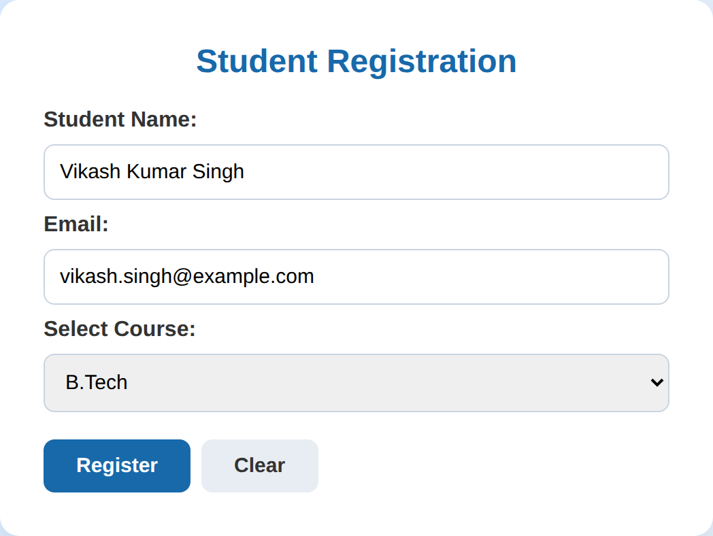
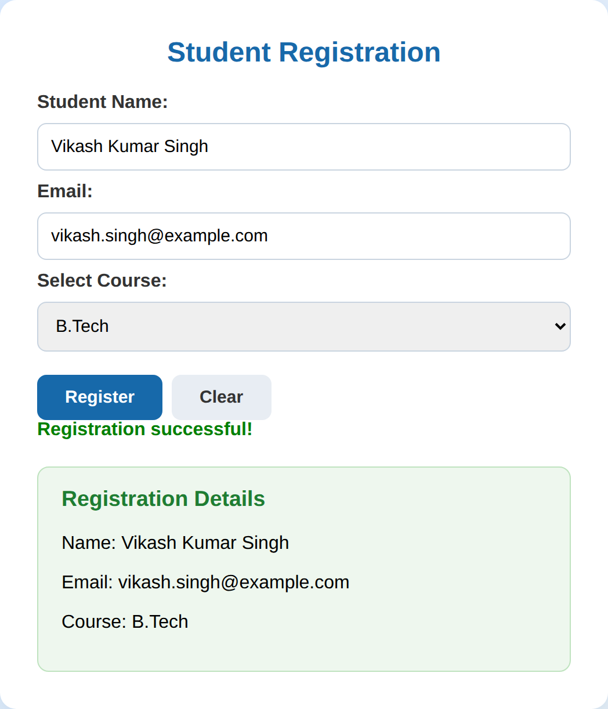
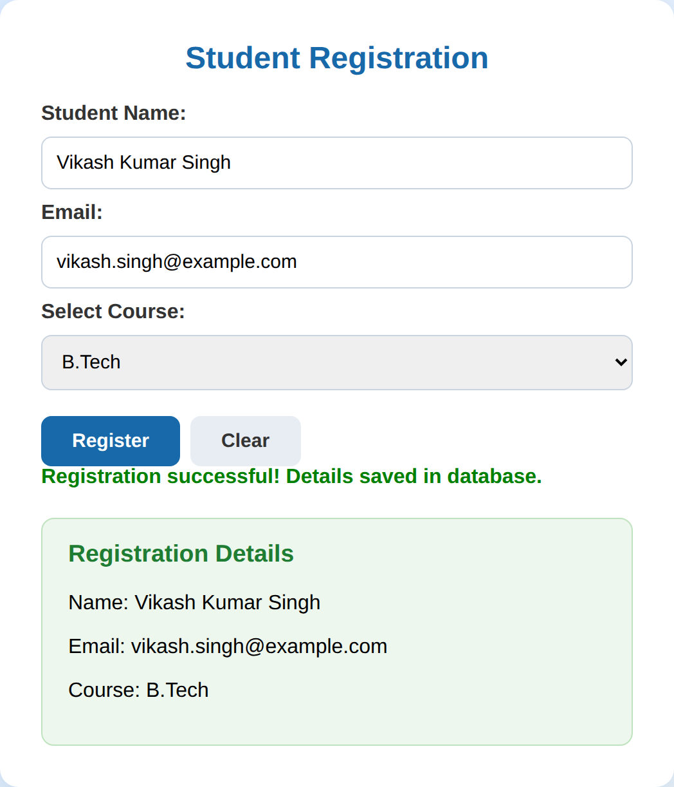
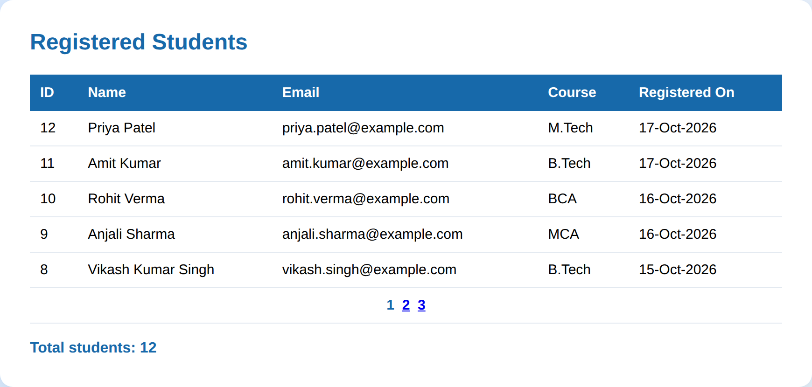
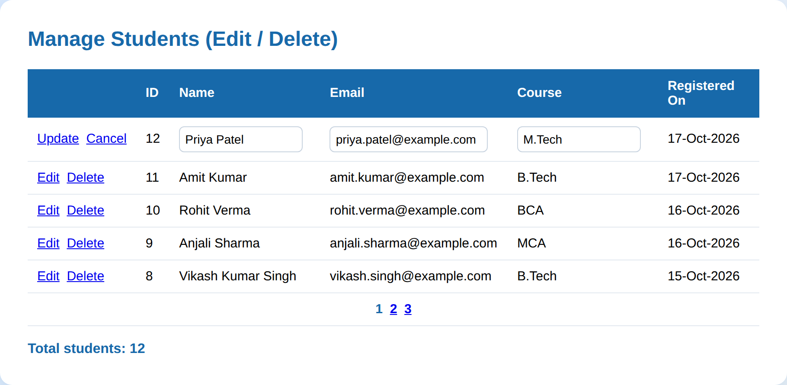
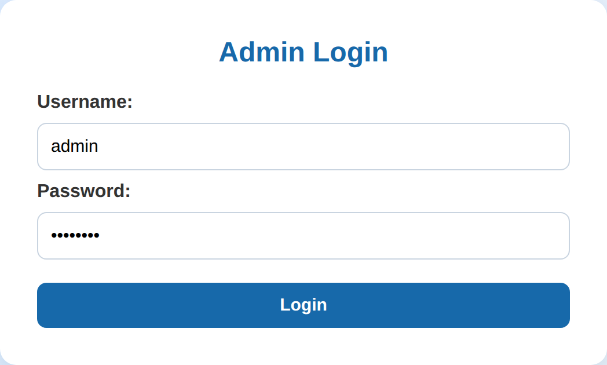
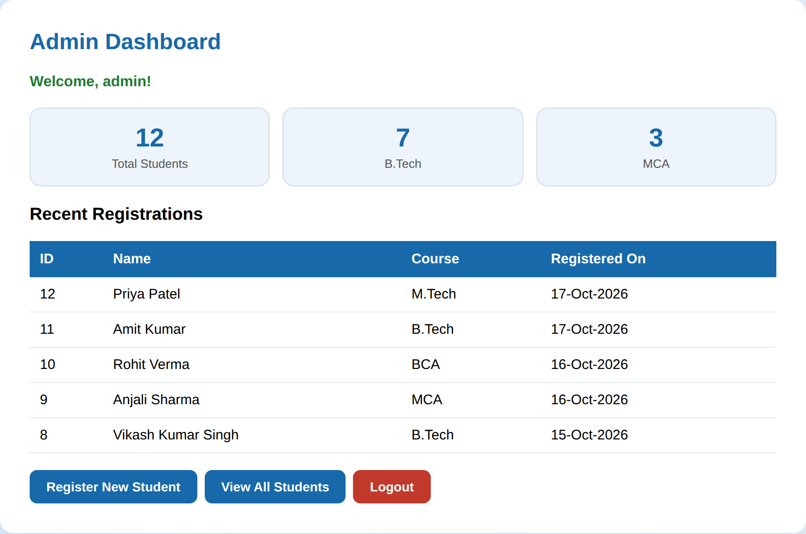

# .NET Program Assignment — ASP.NET Student Registration: 5 Projects


> **Subject:** ASP.NET Web Development
> **Submitted by:** Vikash Kumar Singh — B.Tech CSE (Final Year)
> **Series:** One Student Registration System, built step by step in **5 projects** — from a simple form to a complete login-protected admin system.

---

## The 5 Projects

| # | Project | What it does | New concept |
| --- | --- | --- | --- |
| 1 | [Student Registration](Project1-StudentRegistration/) | Registration form with validation; shows the submitted details on the same page | Web Forms, server controls, validators, postback |
| 2 | [Database Save (ADO.NET)](Project2-DatabaseSave/) | Same form, but every registration is **saved in SQL Server** | ADO.NET — `SqlConnection`, `SqlCommand`, parameters |
| 3 | [GridView Display](Project3-GridViewDisplay/) | A Students page that **shows all registrations in a GridView** with paging and total count | `SqlDataAdapter`, `DataTable`, GridView paging |
| 4 | [Full CRUD](Project4-FullCRUD/) | The GridView can **edit (update) and delete** student records | GridView row events, `DataKeyNames`, UPDATE / DELETE |
| 5 | [Login + Admin Dashboard](Project5-LoginAndDashboard/) | **Admin login** (Session-based), a dashboard with counts and recent registrations, logout; protected pages | Authentication, Session state, dashboard |

**How the projects connect:** Every project is the previous project plus one new skill. Project 1 takes the data, Project 2 saves it, Project 3 shows it, Project 4 manages it, and Project 5 protects it.

---

## Project 1 — Student Registration

A Web Forms page that accepts a student's name, email and course, validates every field, and displays the submitted details with a **"Registration successful!"** message. A Clear button resets the form. No database in this project.





**Concepts:** server controls (`TextBox`, `DropDownList`, `Button`, `Label`, `Panel`), `runat="server"`, RequiredFieldValidator + RegularExpressionValidator, `Page.IsValid`, postback and click-event handling, `Server.HtmlEncode()` for safe output.

---

## Project 2 — Save Registrations in SQL Server (ADO.NET)

The same registration form, extended so that on Register the details are **inserted into the `Students` table** of the `StudentDB` database using ADO.NET, and the message becomes **"Registration successful! Details saved in database."**



**Concepts:** ADO.NET, connection string in `Web.config`, `SqlConnection` + `SqlCommand`, `ExecuteNonQuery()`, and **parameterized queries** (`@Name`, `@Email`, `@Course`) — the safe way that prevents SQL injection.

**Files:** `StudentRegistration.aspx` + code-behind, `database.sql` (creates `StudentDB` and the `Students` table), `Web.config` (with connection string).

---

## Project 3 — Display All Students in a GridView

Adds a **Students page** (`Students.aspx`) that fetches every registration from the database and displays it in a GridView with **paging (5 rows per page)** and a **total students count**.



**Concepts:** `SqlDataAdapter` + `DataTable` (disconnected data), `DataSource` / `DataBind()`, GridView `BoundField` columns, date formatting, `OnPageIndexChanging` paging event, loading data only on first load (`!IsPostBack`).

---

## Project 4 — Full CRUD: Edit and Delete

The Students GridView becomes a complete management page: every row gets **Edit** and **Delete** buttons. Edit switches the row into editable text boxes with **Update / Cancel**; Delete removes the record from the database. This completes **Create, Read, Update, Delete**.



**Concepts:** `CommandField` (Edit/Delete buttons), `DataKeyNames="Id"` (safe row identity), GridView events — `RowEditing`, `RowCancelingEdit`, `RowUpdating`, `RowDeleting` — parameterized UPDATE and DELETE queries, `EditIndex`.

---

## Project 5 — Login, Authentication and Admin Dashboard

The final project secures the system. A **Users table** holds an admin account (`admin` / `admin123`, created by `database.sql`). The **Login page** checks the credentials against the database and stores the user in **Session**. The Students and Dashboard pages check the Session first and redirect to Login if it is missing — so nothing opens without logging in.

The **Admin Dashboard** shows count cards (Total Students, B.Tech, MCA), the 5 most recent registrations, quick links, and a **Logout** button that ends the session.





**Concepts:** authentication vs authorization, `ExecuteScalar()` (single-value queries), Session state for login, page-guard pattern, dashboard count queries, `Session.Abandon()` on logout.

---

## Technology Used

| Item | Details |
| --- | --- |
| IDE | Visual Studio 2022 |
| Framework | ASP.NET Web Forms (.NET Framework 4.7.2) |
| Language | C# (code-behind for every page) |
| Database | SQL Server / SQL Express (Projects 2–5) |
| Data access | ADO.NET (no Entity Framework — raw, easy-to-read code) |
| Design | One shared, modern CSS theme in every project — gradient background, card layout, rounded inputs, styled GridView |

## How to Run

> Every project folder contains its own Visual Studio solution (`.sln`) — open it, set the start page, and press **Ctrl + F5**.

**For Projects 2–5, set up the database first:**

1. Open **SQL Server Management Studio (SSMS)** and connect to `.\SQLEXPRESS`.
2. Open the project's **`database.sql`** file and click **Execute** — it creates the `StudentDB` database and its tables.
3. If your SQL Server instance has a different name, update the `connectionString` in that project's `Web.config`.

**Then run the project:**

1. Open the project folder and double-click **`StudentRegistrationSystem.sln`**.
2. In Solution Explorer, right-click the main page and choose **Set as Start Page** (Project 1–4: `StudentRegistration.aspx` or `Students.aspx`; Project 5: start from `Login.aspx`).
3. Press **Ctrl + F5**. For Project 5, log in with **admin / admin123**.

## Project Structure

```
Dotnet-Program-Assignment/
├── README.md
├── screenshots/                        ← Output preview of every project
├── Project1-StudentRegistration/       ← Form + validation (no database)
├── Project2-DatabaseSave/              ← + ADO.NET save to SQL Server (database.sql)
├── Project3-GridViewDisplay/           ← + Students page with GridView and paging
├── Project4-FullCRUD/                  ← + Edit / Update / Delete in the GridView
└── Project5-LoginAndDashboard/         ← + Login, Session guard, Dashboard, Logout
```

Every project folder contains its pages (`.aspx` + `.aspx.cs` + `.aspx.designer.cs`), `Web.config`, its own `.sln` / `.csproj`, and (Projects 2–5) the `database.sql` script.

## Output Screenshots

The images in the `screenshots/` folder and above are **design previews** of each project's output, rendered from the projects' own design and CSS. Running any project in Visual Studio produces this same layout with live data from the database.

## Concepts Map

| Concept | Project |
| --- | --- |
| Web Forms, server controls, validation, postback | 1 |
| ADO.NET connection, command, parameters, SQL injection safety | 2 |
| DataAdapter, DataTable, GridView display and paging | 3 |
| GridView edit/update/delete events, DataKeyNames | 4 |
| Authentication, Session state, dashboard, logout | 5 |

---

*Assignment prepared by Vikash Kumar Singh — B.Tech CSE (Final Year).*
